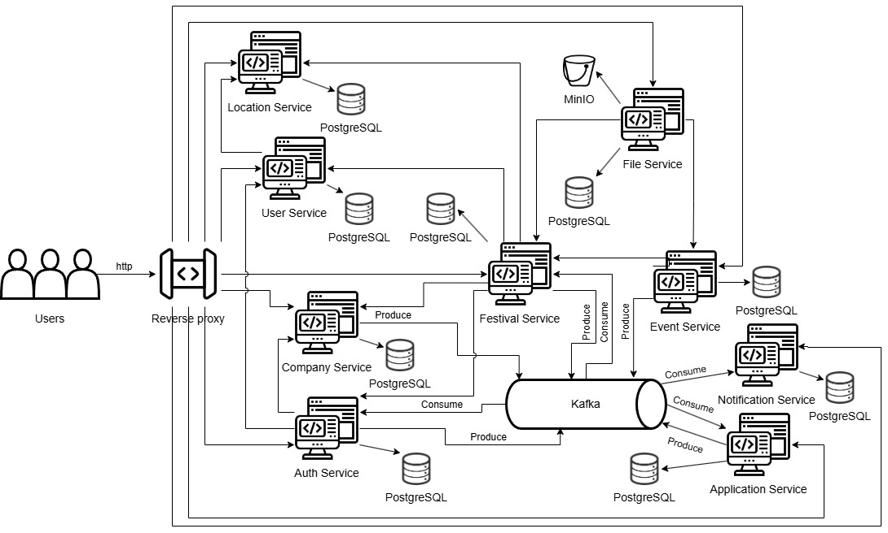

# ФестХаб — платформа управления игровыми фестивалями

Веб-платформа для организации игровых фестивалей: модерация заявок организаторов, расписание мероприятий, продажа билетов с QR-кодами, командные турниры и учёт наград.

Компания подаёт заявку, проходит модерацию и получает доступ в систему. Дальше она создаёт фестиваль: выбирает площадку, составляет расписание мероприятий, назначает кураторов и открывает продажу билетов. Посетители покупают билеты, регистрируются на турниры, собирают команды и получают награды.

Девять сервисов, у каждого собственная база данных. Синхронное взаимодействие построено на OpenFeign, асинхронное — на Kafka.

**Стек:** Java 21 · Spring Boot 4 · Spring Cloud · PostgreSQL · Kafka · MinIO · Liquibase · MapStruct · Gradle · JUnit 5 · Mockito · AssertJ · REST Assured · React 18 · TypeScript · Vite · Docker Compose

## Архитектура

<p align="center">
  
</p>

Все запросы браузера приходят на обратный прокси: он разбирает префикс пути `/api/*` и направляет запрос в нужный сервис. Токен при этом проверяет сам сервис-получатель — фильтры безопасности вынесены в общий модуль `jwt` и подключаются одной аннотацией `@EnableFestivalSecurity`.

Роль прокси исполняют два разных компонента. При локальной разработке это dev-сервер Vite, в Docker — nginx внутри контейнера фронтенда. Карта маршрутов у них общая, поэтому приложение ведёт себя одинаково в обоих режимах.

## Быстрый старт

Из инструментов нужен только Docker: JDK, Gradle и Node собираются внутри образов.

```bash
docker compose up --build -d
```

Команда поднимает 21 контейнер — девять сервисов, девять баз данных, Kafka, MinIO и фронтенд.

| Что | Адрес |
| --- | --- |
| Приложение | http://localhost:3000 |
| Консоль MinIO | http://localhost:9001 (`minioadmin` / `minioadmin`) |

Для входа через Яндекс ID и отправки писем используйте свои ключи: скопируйте `.env.example` в `.env` и заполните значения. Остальная система работает и без них.

## Сервисы

| Сервис | Порт | Зона ответственности |
| --- | --- | --- |
| `applicationservice` | 8081 | Модерация заявок — на регистрацию компании и на проведение фестиваля |
| `authservice` | 8082 | Регистрация и вход, JWT и refresh-токены, вход через Яндекс ID, роли |
| `companyservice` | 8083 | Карточки компаний-организаторов, реквизиты, активация |
| `eventservice` | 8084 | Мероприятия фестиваля, команды участников, стенды, товары и награды |
| `festivalservice` | 8085 | Фестивали и площадки проведения, билеты, назначение кураторов |
| `fileservice` | 8086 | Загрузка изображений в MinIO с проверкой прав доступа |
| `locationservice` | 8087 | Справочники городов и площадок |
| `notificationservice` | 8088 | Уведомления в интерфейсе и письма на почту |
| `userservice` | 8089 | Профили пользователей и чёрный список |

Общий код вынесен в два модуля: `common` — обработка ошибок, конфигурация Feign и Jackson, шифрование; `jwt` — выпуск и проверка токенов, фильтры безопасности.

Роли пользователей: `USER`, `CURATOR`, `COMPANY`, `ADMIN`.

## Инженерные решения

**Своя база данных у каждого сервиса.** Девять независимых схем, общих таблиц нет. Если сервису нужны данные другого сервиса, он запрашивает их через его API, а не читает его базу напрямую. Схемы версионируются Liquibase.

**Kafka для событий, Feign для запросов.** Асинхронно передаётся то, что не должно блокировать действия пользователя и допускает задержку: результаты модерации, выдача доступов компании, приглашения в команду — семь топиков с повторными попытками и очередью недоставленных сообщений. Синхронно, через Feign, запрашивается то, без чего нельзя собрать ответ прямо сейчас: название города для профиля или проверка прав на фестиваль.

**Пессимистические блокировки.** Покупка билета, регистрация на мероприятие и вступление в команду сначала проверяют количество оставшихся мест, а затем занимают одно из них. Чтобы два одновременных запроса не заняли одно и то же место, строка читается с `PESSIMISTIC_WRITE`, и остальные ждут завершения транзакции.

**Проверка токена в каждом сервисе.** Прокси не считается доверенным звеном, поэтому JWT проверяется на стороне каждого сервиса. Для межсервисных вызовов предусмотрен отдельный системный токен и свой фильтр, так что внутренние эндпоинты недоступны снаружи.

**Билет как подписанный токен.** В QR-код билета зашит JWT, который действует 15 минут. При проходе куратор сканирует код, а сервис проверяет подпись, срок действия и то, что билет выдан на этот фестиваль и эту площадку.

**Шифрование персональных данных.** Паспортные данные хранятся в базе в зашифрованном виде и расшифровываются только при выдаче владельцу.

**Сборка падает на незаполненном поле DTO.** Сущности преобразуются в DTO через MapStruct с политикой `unmappedTargetPolicy=ERROR`: если в ответе появилось новое поле, а маппер его не заполняет, проект не соберётся. Без такой проверки это обнаруживается гораздо позже — пустым значением в ответе API.

**Один Dockerfile на девять сервисов.** Стадия сборки у них общая, поэтому Gradle-проект компилируется один раз, а нужный jar выбирается аргументом `SERVICE`. Порты баз данных, Kafka и MinIO проброшены на хост, так что отдельный сервис можно запустить из IDE против инфраструктуры, поднятой в Docker.

## Тесты

```bash
./gradlew test
```

120 модульных тестов на Mockito, по набору на каждый сервис: правила модерации заявок, проверки при покупке билета (возраст, наличие паспорта, остаток мест), ограничения команд, права на загрузку файлов, выдача и обновление токенов. Контекст Spring они не поднимают и к базе данных не обращаются.

Девять смоук-тестов проверяют, что контекст Spring поднимается. Они обращаются к базе данных, поэтому требуют запущенной инфраструктуры (`docker compose up -d`).

Отдельно есть сквозные (end-to-end) тесты: они обращаются к уже запущенной системе по HTTP, как это делал бы реальный клиент. В обычную сборку такие тесты не входят:

```bash
docker compose up -d && ./gradlew e2eTest
```

## Разработка без Docker

```bash
docker compose up -d $(docker compose config --services | grep -E 'postgres|kafka|minio')
```

```bash
./gradlew :authservice:bootRun
# ... и остальные нужные сервисы, каждый в своём терминале
```

```bash
cd frontend && npm install && npm run dev
```

## Использование ИИ-агента

Часть работы выполнена с помощью ИИ-агента Claude Code.

**Бэкенд — моя работа.** Архитектура и модель данных, границы сервисов и порядок их взаимодействия, бизнес-логика — всё это спроектировано, реализовано и протестировано мной. Агент выступал консультантом: советы по библиотекам, ревью кода на типовые ошибки, разбор вариантов архитектуры.

**Фронтенд создан агентом практически полностью.** Приоритетом была работающая демонстрация бэкенда, а не самостоятельная фронтенд-разработка.
